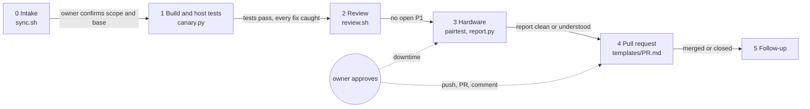

# inference-agent-kit

A standard way for AI coding agents (Claude Code, Codex, Grok and others) to contribute to local-inference serving
stacks: DGX Spark recipes such as Mia's AI Lab's DeepSeek and GLM recipes first, and the same process on Apple Silicon,
RTX workstations or anything with an OpenAI-compatible API (`docs/platforms.md`, `lab.examples/`): one contract every agent reads (`AGENTS.md`), one process with approval
gates, and the scripts that make each stage repeatable, from checking upstream to hardware tests to PR text.

**Built on what Mia's AI Lab gives its contributors.** The attribution rules in `AGENTS.md` §2 are Mia's AI Lab's
*agents-md-credit-and-attribution* guidance, and the contribution rules in §1 are the ones Mia has asked contributors
to follow. The evidence rules in `docs/evidence.md` follow [The Grill](https://github.com/plotarmordev/thegrill)
(`grill-perf`) by [plotarmordev](https://github.com/plotarmordev), the benchmarking tool used by the lab's contributors.
The agent-contract layout follows [gb10-clock-cap](https://github.com/agjs/gb10-clock-cap) by
[agjs](https://github.com/agjs). See [Credits](#credits).

## Quick start

    git clone https://github.com/hecisaza/inference-agent-kit ~/inference-agent-kit && cd ~/inference-agent-kit
    cp owner.example.yaml owner.yaml   # your name, commit email, time zone, attribution policy
    cp lab.example.yaml lab.yaml       # your Sparks: hosts, fabric, build box, what is live, targets
    scripts/install-skill.sh           # optional: the Claude Code skill
    tests/selftest.sh                  # checks the kit itself (no hardware needed)

Then start your agent in the directory of the recipe you work on and tell it to follow `~/inference-agent-kit/AGENTS.md`
(with Claude Code: `/inference-agent-work`).

## What is in it

| Path | Stage | What it does |
|---|---|---|
| `AGENTS.md` | all | the contract: rules never skipped, attribution, the stages and their gates, habits, report shape |
| `docs/process.md` | all | each stage in detail, and what went wrong before when it was skipped |
| `docs/evidence.md` | 1, 3, 4 | baseline / control / check, verdict words, correctness by reply hash, failure-path testing, wording |
| `scripts/sync.sh` | 0 | latest `main`, patch numbers in use and free, open PRs and the patches they touch, collisions, matching issues |
| `scripts/canary.py` | 1 | switches each fix back off in a scratch copy and checks a test catches it |
| `scripts/review.sh` | 2 | builds a read-only review bundle, runs a second agent, extracts `REVIEW.md`, stops a reviewer that hangs |
| `scripts/pairtest` | 3 | from `lab.yaml`: start a target through its backend (`recipe-docker`, `command`, `service`), run suites against a control, probe the platform, report, restore what was live |
| `scripts/report.py` | 3, 4 | visual documentation of a run for reviewers: `report.md` for the PR (tables, SVG charts), `report.html` to share, the "what this does not show" list |
| `suites/` | 3 | `smoke`, `boundary` (chunk ends, prefix cache, sized by the engine's chunk), `soak` (aborts, canary prompts), `cutin`, `fault` (recipe images with a test-only hook); `probes.py` per platform |
| `docs/platforms.md`, `lab.examples/` | 3 | DGX Spark, RTX 6000 / NVIDIA workstation (vLLM, SGLang), Apple Silicon (MLX, llama.cpp): how each is declared |
| `evals/agent26/` | model swaps | 26 agent-style prompts (tools, code, network engineering, maths, formats, Spanish, long context) with a grader and blind side-by-side |
| `templates/` | 2, 4, 5 | PR text, review task, work claim, hand-off comment for someone else's PR |
| `skills/claude/` | all | the Claude Code skill wrapping the process |
| `permissions/` | all | suggested allow/ask lists so routine steps do not stall |

Nothing about your lab is in the kit: `lab.yaml` and `owner.yaml` stay local (`.gitignore`).

## The process

`docs/overview.html` is the same picture as one page (stages, layers, hardware, a sample report).

### In one table

| Stage | Gate |
|---|---|
| 0 Intake (`sync.sh`) | owner confirms scope and base; overlapping work named |
| 1 Build, host tests, canaries | tests pass; every fix caught by a canary |
| 2 Review (`review.sh`) | no open P1; P2s fixed or listed |
| 3 Hardware (`pairtest`) | owner approved the downtime; report clean or understood |
| 4 PR (`templates/PR.md`) | **owner's explicit go** to push and open |
| 5 Follow-up | merged, or closed with a note |

## Credits

- **Mia's AI Lab** ([MiaAI-Lab](https://github.com/MiaAI-Lab)): the *agents-md-credit-and-attribution* rules
  (`AGENTS.md` §2) and the contribution rules (`AGENTS.md` §1, rule 3), and the recipes this kit is for.
- **[The Grill](https://github.com/plotarmordev/thegrill)** by [plotarmordev](https://github.com/plotarmordev): the
  baseline / control / check discipline and verdict vocabulary that `docs/evidence.md` follows.
- **[gb10-clock-cap](https://github.com/agjs/gb10-clock-cap)** by [agjs](https://github.com/agjs): the agent-first
  contract layout (one-command path, preflight gates, decision rule, rollback).
- The scripts, suites and evaluation set were written by Hector Isaza ([hecisaza](https://github.com/hecisaza)),
  generalised from testing and contributing to the DeepSeek-V4.1-Flash and GLM-5.3 recipes.

## License

Apache-2.0 (the same as Mia's AI Lab recipes), unless the owner of this repository chooses otherwise.
